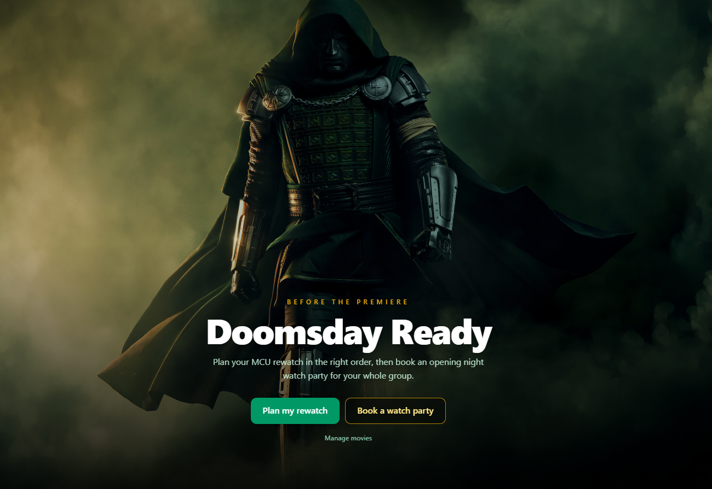
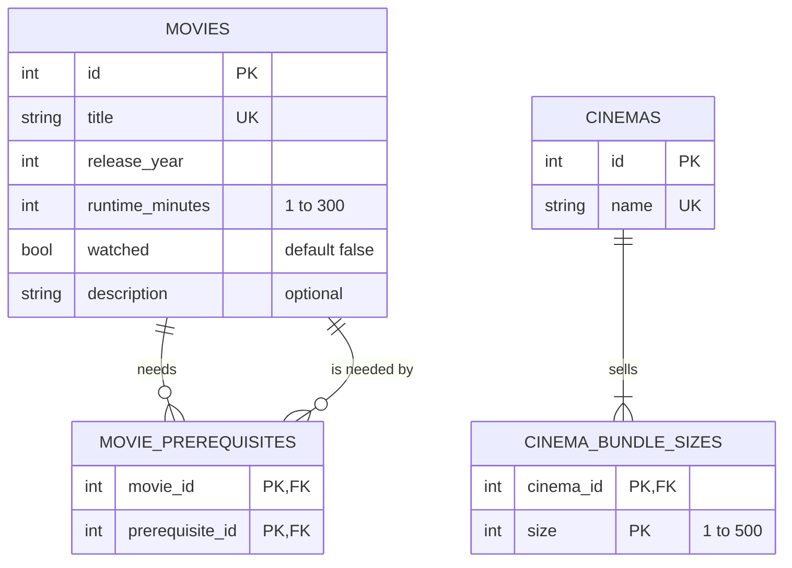

<div align="center">

# Doomsday Ready

**Plan your MCU rewatch in the right order, then book an opening night watch party for your whole group.**

[](https://doomsday-ready-nine.vercel.app)
[](https://doomsday-ready-api-koe8.onrender.com/docs)




</div>

> **Note:** The backend runs on a free plan and sleeps when nobody uses it. The first load can take up to a minute. The app waits and retries on its own, so just give it a moment.

## ✨ Highlights

* **Hand written algorithms:** cycle detection, rewatch order (topological sort) and fewest bundles (dynamic programming), with no graph or algorithm libraries.
* **Clear errors:** a circular dependency is rejected with `409 CIRCULAR_DEPENDENCY`, and the app shows the full cycle, for example `Iron Man -> Avengers: Endgame -> ... -> Iron Man`.
* **43 automated tests** that cover every expected result in the task.
* **One command start** with Docker Compose, with the sample data loaded automatically.
* **Live deployment** on Vercel, Render and Neon.
* A themed UI with posters, short movie descriptions, glass style cards, and a mobile layout.

## 🎬 Features

### Movies
* Add movies with title, release year, runtime and prerequisites.
* Edit prerequisites later and mark movies as watched.
* Each movie shows its poster and a short description.
* A movie can never depend on itself, directly or through other movies.

### Rewatch plan
* Pick a target movie and get every movie to watch before it, each once, in a valid order.
* Watched ticks, a progress bar such as "2 of 7 watched", and the remaining watch time.

### Booking
* Pick a cinema and a group size to get the fewest bundles that add up to exactly the group size, or "Not possible".
* Add new cinemas with their own bundle sizes.

## 🛠 Tech stack

| Part | Tools |
|---|---|
| Frontend | Vite, React, TypeScript, Tailwind CSS |
| Backend | Python 3.12, FastAPI, Pydantic, SQLAlchemy |
| Database | PostgreSQL |
| Tests | pytest (43 tests) |
| Run locally | Docker Compose, nginx for the frontend container |
| Live | Vercel (frontend), Render (backend), Neon (database) |

## 🐳 Run with Docker (recommended)

```bash
git clone https://github.com/ShArafat58/doomsday-ready.git
cd doomsday-ready
docker compose up --build
```

* App: http://localhost:8080
* API docs (Swagger): http://localhost:8000/docs

The sample data from the task (8 movies and 4 cinemas) loads automatically the first time the database is empty.

```bash
docker compose exec backend python -m pytest   # run the tests
docker compose down -v                          # stop and delete the database
```

## 💻 Run without Docker

Requirements: Python 3.12, Node 20 or newer, and PostgreSQL. The easiest way to get PostgreSQL is `docker compose up -d db`, which listens on port 5433.

1. Copy `.env.example` to `.env`.
2. Backend:

```bash
cd backend
python -m venv .venv
.venv\Scripts\activate          # Windows
source .venv/bin/activate       # macOS or Linux
pip install -r requirements.txt
python -m app.seed              # loads the sample data
uvicorn app.main:app --reload
```

3. Frontend, in a second terminal:

```bash
cd frontend
npm install
npm run dev
```

Open http://localhost:5173. Vite forwards every `/api` request to the backend on port 8000.

4. Tests: run `python -m pytest` inside `backend`. The tests use a separate `doomsday_test` database, which they create automatically, so your own data stays safe.

## 🔌 API

All endpoints are under `/api`.

| Method and path | Purpose | Success | Errors |
|---|---|---|---|
| `POST /movies` | Create a movie | 201 | 409 title taken, 422 bad input or unknown prerequisite |
| `GET /movies` | List movies | 200 | |
| `GET /movies/{id}` | Get one movie | 200 | 404 |
| `PATCH /movies/{id}` | Update any field, including `watched`, `prerequisiteIds` and `description` | 200 | 404, 409 `CIRCULAR_DEPENDENCY`, 409 title taken, 422 |
| `GET /movies/{id}/rewatch-order` | Rewatch order (feature 1) | 200 | 404 |
| `POST /cinemas` | Create a cinema | 201 | 409 name taken, 422 bad bundle sizes |
| `GET /cinemas` | List cinemas | 200 | |
| `GET /cinemas/{id}` | Get one cinema | 200 | 404 |
| `GET /cinemas/{id}/booking?groupSize=6` | Booking quote (feature 2) | 200 | 404, 422 group size outside 1 to 10000 |

Example request body for a movie:

```json
{ "title": "The Avengers", "releaseYear": 2012, "runtimeMinutes": 143, "prerequisiteIds": [1, 2] }
```

Example booking quote for sizes 6, 9 and 20 and a group of 44:

```json
{ "possible": true, "totalBundles": 4, "bundles": [{ "size": 20, "count": 1 }, { "size": 9, "count": 2 }, { "size": 6, "count": 1 }], "message": "4 bundles: 20 x 1, 9 x 2, 6 x 1" }
```

Every error uses the same shape:

```json
{ "error": { "code": "CIRCULAR_DEPENDENCY", "message": "...", "details": { "cycle": ["Iron Man", "Avengers: Endgame", "...", "Iron Man"] } } }
```

## 🗂 Data model



* Prerequisites form a directed graph. Each row in `movie_prerequisites` is one edge: "this movie needs that movie first". The two columns together are the primary key, so the same edge cannot be stored twice.
* `cinema_bundle_sizes` uses `(cinema_id, size)` as the primary key, so a cinema cannot have the same size twice.
* The database also checks the runtime range, the bundle size range, and that a movie is not its own prerequisite, as a last line of defence behind the API validation.

## 🧠 How the algorithms work

All three are written by hand in `backend/app/algorithms`, without graph or algorithm libraries.

### Cycle detection (`graph.py`, `find_cycle`)

Edges point from a movie to its prerequisites. If movie M gets new prerequisites P, a cycle appears only when M can already be reached by starting from one of P and following prerequisite edges. The function runs an iterative depth first search from P. If it reaches M, it rebuilds the path from a parent map and the API returns 409 with that path. Giving a movie itself as a prerequisite is the shortest possible cycle.

A brand new movie cannot create a cycle, because no other movie depends on it yet, so the check runs on update.

**Time:** O(V + E), where V is the number of movies and E the number of prerequisite links.

### Rewatch order (`graph.py`, `rewatch_order`)

This is a topological sort using depth first search in post order. For each prerequisite of the target, the function first visits that movie's own prerequisites and only then adds the movie to the list. So every movie appears after all of its prerequisites. A visited set makes sure each movie appears once, and the target itself is never added.

Before sorting, each movie's prerequisites are ordered by release year and then title, so the result is stable. For Avengers: Doomsday it gives exactly the order shown in the task: Iron Man, The First Avenger, The Avengers, Civil War, Ragnarok, Infinity War, Endgame. The service then counts watched movies and adds up the runtime of the unwatched ones.

**Time:** O(V + E).

### Fewest bundles (`booking.py`, `fewest_bundles`)

This is dynamic programming, like the classic coin change problem. `best[s]` is the fewest bundles that give exactly `s` seats, with `best[0] = 0`. For every seat count from 1 to the group size, and for every bundle size, it tries `best[s - size] + 1` and keeps the smallest. `last[s]` remembers the bundle used, so the answer can be rebuilt by walking back from the group size. If the group size cannot be reached, the answer is "Not possible".

A greedy approach does not work here. With sizes 6, 9 and 20 and a group of 44, taking the biggest bundle first gives 20 + 20 and leaves 4 seats that cannot be filled. The right answer is 20 + 9 + 9 + 6.

**Time:** O(N x K), where N is the group size (at most 10000) and K the number of sizes (at most 10), so at most 100000 steps.

## ☁️ Deployment

| Part | Where | Notes |
|---|---|---|
| Frontend | [Vercel](https://doomsday-ready-nine.vercel.app) | Built from the `frontend` folder. `frontend/vercel.json` forwards every `/api` request to the backend. |
| Backend | [Render](https://doomsday-ready-api-koe8.onrender.com/docs) | Free web service, built from `backend/Dockerfile`. |
| Database | Neon | Free Postgres in Singapore, close to the Render region. |

The backend reads the connection string from the `DATABASE_URL` environment variable, so no password is stored in the repository.

The free backend sleeps after 15 minutes without traffic, and the first request after that can take up to a minute. The frontend retries read requests every 10 seconds for up to about a minute and shows a short loading message while the server wakes up. Create and update requests are never retried, so nothing is saved twice.

## 📝 Assumptions

* Prerequisites are sent as movie IDs in `prerequisiteIds`. A PATCH with `prerequisiteIds` replaces the whole list.
* Release year must be between 1900 and 2100. The task did not give a range.
* Movie titles and cinema names are unique without regard to letter case, so "Iron Man" and "iron man" count as the same title.
* A prerequisite ID that does not exist returns 422 `PREREQUISITE_NOT_FOUND`. The same ID sent twice is counted once.
* A cinema with the same bundle size twice is rejected with 422, because the task says "different" sizes.
* When several answers use the same fewest number of bundles, the one that uses larger bundles is returned.
* The rewatch order is stable: when two movies could come in either order, the older one comes first.
* The runtime of Avengers: Doomsday is not known yet, so the sample data uses 150 minutes. The other runtimes are the real theatrical runtimes.
* The task did not name the cinemas, so the four sample cinemas have made up names.
* Each movie can have an optional short description of up to 500 characters. The sample descriptions are written in my own words. Movies added from the UI have no description.
* Tables are created on startup. There are no delete endpoints, because the task did not ask for them.

## ✅ Tests

```bash
docker compose exec backend python -m pytest
```

* `tests/test_graph.py` and `tests/test_booking.py` test the algorithms directly, without a database.
* `tests/test_api.py` checks every expected result in the task through the API: the three rewatch examples, the 409 example and the four booking examples, plus validation, descriptions and 404 cases.

## 🤖 How I used AI

### Tools
* **Claude** (Claude Max plan). I have used Claude for a long time, so I am comfortable planning and building with it in small, controlled steps.
* **Google Antigravity** as my editor and terminal. I did not use its built in AI agent.
* I have a Groq API key, but the task does not need any AI feature, so the app does not call any AI API.

### How we worked together
* I gave Claude the full task first. We discussed it, Claude listed the unclear points with a suggested choice for each (these became the Assumptions above), and we agreed on a plan of small steps: setup, database, movie API, rewatch order, booking, tests, frontend, Docker, README and deployment.
* We worked like a small team. Claude suggested options and explained the trade offs, I suggested my own ideas, and we discussed them together.
* **Every final decision was mine.** Claude asked for my approval before each step and before any choice, and each step ended with a way for me to check it.

### Who did what
* Claude wrote most of the code.
* I reviewed the code, ran every step on my own machine, tested each result against the task, found errors and reported them, and checked everything again and again before submitting.
* I studied the algorithms and the test cases so I can explain them.
* I made the design and product decisions: the green and gold Doctor Doom theme, the landing page, posters in the rewatch plan and the movie list, short movie descriptions, the glass style cards, the back button, the hand cursor on clickable items, the mobile layout, the font and poster sizes, and deploying on Vercel and Render.

### Problems we hit and how we solved them
* Docker Desktop would not install at first. It needed an all users install and then `wsl --update`.
* `git push` failed with 403 because another GitHub account was saved on my PC. I put my username in the remote URL.
* Long pastes crashed PowerShell. Turning off PSReadLine in my PowerShell profile fixed it.
* A newer Pydantic version printed alias warnings with FastAPI, so I pinned the Pydantic version.
* The frontend container stopped at once. The logs showed nginx could not read its config because PowerShell had added a hidden BOM character, so I saved the file without it.
* After the first deploy, the live site showed `502` errors because the free backend was asleep. The frontend now retries read requests while the server wakes up and shows a loading message.

### How AI made me faster
* Claude gave each step as one terminal command that wrote several files at once, so I did not create files by hand.
* Instead of clicking through Swagger, we checked many API cases with one small Python script.
* The pytest suite let me check all the expected results again in seconds after every change.
* Claude compressed the images (from 3.9 MB to 336 KB), so the live site loads faster.

## 🔭 What I would improve with more time

* Database migrations with Alembic instead of creating tables on startup.
* Delete endpoints for movies and cinemas.
* Frontend tests with Vitest and React Testing Library.
* A warning in the UI before saving a change that would create a cycle.
* Watched status per user with login. Right now it is shared by everyone.
* Poster and description fields in the UI, so new movies can have them too.
* GitHub Actions to run the tests on every push.
* A paid backend plan, so the live demo never sleeps.

## 🖼 Image credits

The background images and movie posters belong to Marvel Studios and Disney. They are used only for this non commercial project.
